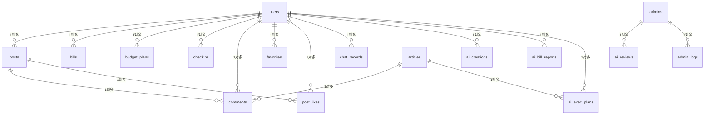

# 省钱攻略 · 数据库设计说明

> 生成日期 2026-11-09；由 `scripts/gen_db_doc.py` 从真实 MySQL introspect 生成，与库结构一致。

## 一、表清单（共 18 张关系表）

| 表 | 用途 | 字段数 | 主键 |
|---|---|---|---|
| admin_logs | 管理操作留痕 | 8 | id |
| admins | 管理端账号 | 4 | id |
| ai_bill_reports | AI 账单报告 | 7 | id |
| ai_creations | AI 创作记录 | 9 | id |
| ai_exec_plans | AI 执行计划 | 11 | id |
| ai_reviews | AI 审核辅助 | 7 | id |
| articles | 省钱攻略 | 12 | id |
| bills | 消费账单 | 10 | id |
| budget_plans | 月度预算/省钱目标 | 8 | id |
| chat_records | AI 对话历史 | 10 | id |
| checkins | 实际节省记录 | 9 | id |
| comments | 评论 | 7 | id |
| coupon_activities | 优惠活动 | 7 | id |
| favorites | 收藏 | 5 | id |
| post_likes | 帖子点赞 | 4 | id |
| posts | 社区帖子 | 10 | id |
| price_histories | 商品历史报价 | 6 | id |
| users | 小程序用户 | 9 | id |

ChromaDB 向量库（攻略知识检索）不计入关系表。

## 二、字段说明

### admin_logs（管理操作留痕）

| 字段 | 类型 | 可空 | 键 | 说明 |
|---|---|---|---|---|
| id | INTEGER | NO | PK | 主键 |
| admin_id | INTEGER | NO | IDX | 操作管理员 |
| admin_name | VARCHAR(50) COLLATE "utf8mb4_unicode_ci" | YES |  | 管理员账号快照 |
| action | VARCHAR(40) COLLATE "utf8mb4_unicode_ci" | NO |  | 动作 create/update/delete/status |
| target_type | VARCHAR(30) COLLATE "utf8mb4_unicode_ci" | YES |  | 对象类型 |
| target_id | INTEGER | YES |  | 对象 ID |
| detail | VARCHAR(300) COLLATE "utf8mb4_unicode_ci" | YES |  | 一句话说明 |
| created_at | DATETIME | YES |  | 操作时间 |

### admins（管理端账号）

| 字段 | 类型 | 可空 | 键 | 说明 |
|---|---|---|---|---|
| id | INTEGER | NO | PK | 主键 |
| username | VARCHAR(50) COLLATE "utf8mb4_unicode_ci" | NO | IDX | 管理员账号(唯一) |
| password_hash | VARCHAR(128) COLLATE "utf8mb4_unicode_ci" | NO |  | 密码哈希 |
| created_at | DATETIME | YES |  | 创建时间 |

### ai_bill_reports（AI 账单报告）

| 字段 | 类型 | 可空 | 键 | 说明 |
|---|---|---|---|---|
| id | INTEGER | NO | PK | 主键 |
| user_id | INTEGER | NO | IDX | 用户 |
| month | VARCHAR(7) COLLATE "utf8mb4_unicode_ci" | NO |  | 报告月份 |
| stats_json | TEXT COLLATE "utf8mb4_unicode_ci" | YES |  | 程序统计快照 |
| report_json | TEXT COLLATE "utf8mb4_unicode_ci" | YES |  | AI 解读 |
| model | VARCHAR(40) COLLATE "utf8mb4_unicode_ci" | YES |  | 模型名 |
| created_at | DATETIME | YES |  | 生成时间 |

### ai_creations（AI 创作记录）

| 字段 | 类型 | 可空 | 键 | 说明 |
|---|---|---|---|---|
| id | INTEGER | NO | PK | 主键 |
| user_id | INTEGER | NO | IDX | 用户 |
| scene | VARCHAR(20) COLLATE "utf8mb4_unicode_ci" | YES |  | article/post |
| mode | VARCHAR(20) COLLATE "utf8mb4_unicode_ci" | YES |  | generate/title/polish/reorganize |
| input_json | TEXT COLLATE "utf8mb4_unicode_ci" | YES |  | 用户输入 |
| output_json | TEXT COLLATE "utf8mb4_unicode_ci" | YES |  | 模型结构化输出 |
| article_id | INTEGER | YES |  | 发布后回填的攻略 |
| model | VARCHAR(40) COLLATE "utf8mb4_unicode_ci" | YES |  | 模型名 |
| created_at | DATETIME | YES |  | 创建时间 |

### ai_exec_plans（AI 执行计划）

| 字段 | 类型 | 可空 | 键 | 说明 |
|---|---|---|---|---|
| id | INTEGER | NO | PK | 主键 |
| user_id | INTEGER | NO | IDX | 用户 |
| article_id | INTEGER | YES |  | 来源攻略 |
| title | VARCHAR(200) COLLATE "utf8mb4_unicode_ci" | YES |  | 计划标题 |
| plan_json | TEXT COLLATE "utf8mb4_unicode_ci" | YES |  | 步骤/清单 JSON |
| est_saving | FLOAT | YES |  | AI 预计可省(仅参考) |
| actual_saving | FLOAT | YES |  | 用户确认实际节省(镜像) |
| status | VARCHAR(20) COLLATE "utf8mb4_unicode_ci" | YES |  | 进行中/已完成 |
| model | VARCHAR(40) COLLATE "utf8mb4_unicode_ci" | YES |  | 模型名 |
| created_at | DATETIME | YES |  | 创建时间 |
| updated_at | DATETIME | YES |  | 更新时间 |

### ai_reviews（AI 审核辅助）

| 字段 | 类型 | 可空 | 键 | 说明 |
|---|---|---|---|---|
| id | INTEGER | NO | PK | 主键 |
| target_type | VARCHAR(10) COLLATE "utf8mb4_unicode_ci" | NO |  | article/post |
| target_id | INTEGER | NO | IDX | 审核对象 |
| result_json | TEXT COLLATE "utf8mb4_unicode_ci" | YES |  | AI 风险/质量意见 |
| model | VARCHAR(40) COLLATE "utf8mb4_unicode_ci" | YES |  | 模型名 |
| admin_id | INTEGER | YES |  | 触发管理员 |
| created_at | DATETIME | YES |  | 分析时间 |

### articles（省钱攻略）

| 字段 | 类型 | 可空 | 键 | 说明 |
|---|---|---|---|---|
| id | INTEGER | NO | PK | 主键 |
| title | VARCHAR(200) COLLATE "utf8mb4_unicode_ci" | NO |  | 标题 |
| content | TEXT COLLATE "utf8mb4_unicode_ci" | NO |  | 正文(Markdown) |
| category | VARCHAR(50) COLLATE "utf8mb4_unicode_ci" | YES |  | 分类 |
| cover | VARCHAR(500) COLLATE "utf8mb4_unicode_ci" | YES |  | 封面 URL |
| author | VARCHAR(50) COLLATE "utf8mb4_unicode_ci" | YES |  | 作者 |
| likes | INTEGER | YES |  | 点赞数 |
| views | INTEGER | YES |  | 浏览量 |
| created_at | DATETIME | YES |  | 创建时间 |
| images | TEXT COLLATE "utf8mb4_unicode_ci" | YES |  | 配图 JSON 数组 |
| user_id | INTEGER | YES |  | 投稿人(0=管理端) |
| status | VARCHAR(20) COLLATE "utf8mb4_unicode_ci" | YES |  | pending/approved/rejected |

### bills（消费账单）

| 字段 | 类型 | 可空 | 键 | 说明 |
|---|---|---|---|---|
| id | INTEGER | NO | PK | 主键 |
| user_id | INTEGER | NO |  | 用户 |
| amount | FLOAT | NO |  | 金额(元) |
| category | VARCHAR(50) COLLATE "utf8mb4_unicode_ci" | YES |  | 消费分类 |
| source | VARCHAR(100) COLLATE "utf8mb4_unicode_ci" | YES |  | 用途备注 |
| bill_date | DATE | YES |  | 消费日期 |
| ocr_raw | TEXT COLLATE "utf8mb4_unicode_ci" | YES |  | OCR 原始数据 |
| created_at | DATETIME | YES |  | 创建时间 |
| pay_channel | VARCHAR(30) COLLATE "utf8mb4_unicode_ci" | YES |  | 支付平台 |
| order_no | VARCHAR(64) COLLATE "utf8mb4_unicode_ci" | YES |  | 交易单号 |

### budget_plans（月度预算/省钱目标）

| 字段 | 类型 | 可空 | 键 | 说明 |
|---|---|---|---|---|
| id | INTEGER | NO | PK | 主键 |
| user_id | INTEGER | NO |  | 用户 |
| month | VARCHAR(7) COLLATE "utf8mb4_unicode_ci" | NO |  | 月份 YYYY-MM |
| target_amount | FLOAT | YES |  | 省钱目标 |
| saved_amount | FLOAT | YES |  | 已省(由 checkins 重算) |
| checkin_days | INTEGER | YES |  | 打卡天数 |
| last_checkin_date | DATETIME | YES |  | 最近打卡 |
| spend_limit | FLOAT | YES |  | 支出上限 |

### chat_records（AI 对话历史）

| 字段 | 类型 | 可空 | 键 | 说明 |
|---|---|---|---|---|
| id | INTEGER | NO | PK | 主键 |
| user_id | INTEGER | NO |  | 用户 |
| role | VARCHAR(20) COLLATE "utf8mb4_unicode_ci" | NO |  | user/assistant/tool |
| content | TEXT COLLATE "utf8mb4_unicode_ci" | YES |  | 消息内容 |
| tool_calls | TEXT COLLATE "utf8mb4_unicode_ci" | YES |  | 工具调用 JSON |
| tokens_used | INTEGER | YES |  | 消耗 token |
| created_at | DATETIME | YES |  | 创建时间 |
| agent | VARCHAR(20) COLLATE "utf8mb4_unicode_ci" | YES |  | coupon/budget |
| links | TEXT COLLATE "utf8mb4_unicode_ci" | YES |  | 跳转卡片 JSON |
| tables | TEXT COLLATE "utf8mb4_unicode_ci" | YES |  | 表格 JSON |

### checkins（实际节省记录）

| 字段 | 类型 | 可空 | 键 | 说明 |
|---|---|---|---|---|
| id | INTEGER | NO | PK | 主键 |
| user_id | INTEGER | NO | IDX | 用户 |
| day | DATE | NO |  | 记录日期 |
| saved_amount | FLOAT | YES |  | 本笔实际节省 |
| note | VARCHAR(120) COLLATE "utf8mb4_unicode_ci" | YES |  | 备注 |
| created_at | DATETIME | YES |  | 创建时间 |
| source | VARCHAR(20) COLLATE "utf8mb4_unicode_ci" | NO |  | 打卡/攻略/社区经验/AI方案 |
| ref_type | VARCHAR(20) COLLATE "utf8mb4_unicode_ci" | NO |  | 关联类型 |
| ref_id | INTEGER | YES |  | 关联内容 ID |

### comments（评论）

| 字段 | 类型 | 可空 | 键 | 说明 |
|---|---|---|---|---|
| id | INTEGER | NO | PK | 主键 |
| user_id | INTEGER | NO |  | 评论者 |
| target_type | VARCHAR(20) COLLATE "utf8mb4_unicode_ci" | NO |  | article/post |
| target_id | INTEGER | NO |  | 目标 ID |
| content | TEXT COLLATE "utf8mb4_unicode_ci" | NO |  | 评论内容 |
| parent_id | INTEGER | YES |  | 父评论(0=一级) |
| created_at | DATETIME | YES |  | 创建时间 |

### coupon_activities（优惠活动）

| 字段 | 类型 | 可空 | 键 | 说明 |
|---|---|---|---|---|
| id | INTEGER | NO | PK | 主键 |
| title | VARCHAR(200) COLLATE "utf8mb4_unicode_ci" | NO |  | 活动标题 |
| content | TEXT COLLATE "utf8mb4_unicode_ci" | YES |  | 详情 |
| platform | VARCHAR(50) COLLATE "utf8mb4_unicode_ci" | YES |  | 平台 |
| deadline | DATETIME | YES |  | 截止时间 |
| verified | INTEGER | YES |  | 是否已验证 |
| created_at | DATETIME | YES |  | 创建时间 |

### favorites（收藏）

| 字段 | 类型 | 可空 | 键 | 说明 |
|---|---|---|---|---|
| id | INTEGER | NO | PK | 主键 |
| user_id | INTEGER | NO |  | 收藏用户 |
| target_type | VARCHAR(20) COLLATE "utf8mb4_unicode_ci" | NO |  | article/post |
| target_id | INTEGER | NO |  | 目标 ID |
| created_at | DATETIME | YES |  | 收藏时间 |

### post_likes（帖子点赞）

| 字段 | 类型 | 可空 | 键 | 说明 |
|---|---|---|---|---|
| id | INTEGER | NO | PK | 主键 |
| user_id | INTEGER | NO | IDX | 点赞用户 |
| post_id | INTEGER | NO | IDX | 帖子 |
| created_at | DATETIME | YES |  | 点赞时间 |

### posts（社区帖子）

| 字段 | 类型 | 可空 | 键 | 说明 |
|---|---|---|---|---|
| id | INTEGER | NO | PK | 主键 |
| user_id | INTEGER | NO |  | 发帖人 |
| title | VARCHAR(200) COLLATE "utf8mb4_unicode_ci" | NO |  | 标题 |
| content | TEXT COLLATE "utf8mb4_unicode_ci" | NO |  | 正文 |
| images | TEXT COLLATE "utf8mb4_unicode_ci" | YES |  | 图片 JSON |
| tags | VARCHAR(200) COLLATE "utf8mb4_unicode_ci" | YES |  | 标签(逗号分隔) |
| status | VARCHAR(20) COLLATE "utf8mb4_unicode_ci" | YES |  | pending/approved/rejected |
| likes | INTEGER | YES |  | 点赞数 |
| comments_count | INTEGER | YES |  | 评论数 |
| created_at | DATETIME | YES |  | 创建时间 |

### price_histories（商品历史报价）

| 字段 | 类型 | 可空 | 键 | 说明 |
|---|---|---|---|---|
| id | INTEGER | NO | PK | 主键 |
| product_name | VARCHAR(200) COLLATE "utf8mb4_unicode_ci" | NO |  | 商品名 |
| price | FLOAT | NO |  | 价格 |
| platform | VARCHAR(50) COLLATE "utf8mb4_unicode_ci" | YES |  | 平台 |
| url | VARCHAR(500) COLLATE "utf8mb4_unicode_ci" | YES |  | 商品链接 |
| recorded_at | DATETIME | YES |  | 记录时间 |

### users（小程序用户）

| 字段 | 类型 | 可空 | 键 | 说明 |
|---|---|---|---|---|
| id | INTEGER | NO | PK | 主键 |
| openid | VARCHAR(64) COLLATE "utf8mb4_unicode_ci" | YES | IDX | 微信 openid（唯一） |
| nickname | VARCHAR(50) COLLATE "utf8mb4_unicode_ci" | YES |  | 昵称 |
| avatar | VARCHAR(500) COLLATE "utf8mb4_unicode_ci" | YES |  | 头像 URL |
| budget_goal | FLOAT | YES |  | 月度省钱目标(元) |
| total_saved | FLOAT | YES |  | 累计已省(元) |
| created_at | DATETIME | YES |  | 注册时间 |
| password_hash | VARCHAR(120) COLLATE "utf8mb4_unicode_ci" | YES |  | 昵称密码登录的 bcrypt 哈希 |
| status | VARCHAR(20) COLLATE "utf8mb4_unicode_ci" | NO |  | 账号状态 active/disabled/deleted |

## 三、主键与外键说明

- 所有表主键均为 `id`（INT 自增）。

- 本项目**未建物理外键约束**（MySQL 层 FK 为空），表间关联通过业务字段（`user_id`/`target_id`/`post_id` 等）在应用层维护，删除时由业务代码处理关联（用户删除为软删除，保留业务数据）。逻辑外键如下：

| 子表.字段 | 指向 | 说明 |
|---|---|---|
| articles.user_id | users.id | 投稿人(0=官方) |
| posts.user_id | users.id | 发帖人 |
| comments.user_id | users.id | 评论者 |
| comments.target_id | articles/posts.id | 按 target_type 指向 |
| post_likes.user_id | users.id |  |
| post_likes.post_id | posts.id |  |
| favorites.user_id | users.id |  |
| favorites.target_id | articles/posts.id | 按 target_type |
| bills.user_id | users.id |  |
| budget_plans.user_id | users.id |  |
| checkins.user_id | users.id |  |
| checkins.ref_id | articles/posts.id | 按 ref_type |
| chat_records.user_id | users.id |  |
| ai_creations.user_id | users.id |  |
| ai_creations.article_id | articles.id | 发布回填 |
| ai_bill_reports.user_id | users.id |  |
| ai_exec_plans.user_id | users.id |  |
| ai_exec_plans.article_id | articles.id |  |
| ai_reviews.target_id | articles/posts.id | 按 target_type |
| ai_reviews.admin_id | admins.id |  |
| admin_logs.admin_id | admins.id |  |

## 四、E-R 图

## 五、核心 CRUD 接口清单

| 实体 | 创建 | 查询 | 修改 | 删除 |
|---|---|---|---|---|
| 用户(管理) | 小程序注册 /auth/register | GET /admin/api/users | PATCH /admin/api/users/{id} | DELETE /admin/api/users/{id}(软删除) |
| 管理员 | POST /admin/api/admins | GET /admin/api/admins | PATCH /admin/api/admins/{id}/password | DELETE /admin/api/admins/{id} |
| 攻略 | POST /admin/api/articles | GET /admin/api/articles | PUT /admin/api/articles/{id} | DELETE /admin/api/articles/{id} |
| 帖子 | POST /admin/api/posts | GET /admin/api/posts | PUT /admin/api/posts/{id} | DELETE /admin/api/posts/{id} |
| 评论 | 小程序 /comments | GET /admin/api/comments | - | DELETE /admin/api/comments/{id} / batch-delete |
| 报价 | POST /admin/api/prices | GET /admin/api/prices | PUT /admin/api/prices/{id} | DELETE /admin/api/prices/{id} |
| 活动 | POST /admin/api/coupons | GET /admin/api/coupons | PUT /admin/api/coupons/{id} | DELETE /admin/api/coupons/{id} |
| 账单(用户端) | POST /bills | GET /bills | PUT /bills/{id} | DELETE /bills/{id} |

审核状态：PATCH /admin/api/articles/{id}/status、/admin/api/posts/{id}/status；AI 辅助：POST /admin/api/ai-review（仅参考，不替代人工）。

## 六、初始化与迁移

1. 配好 `backend/.env` 的 `DATABASE_URL`。

2. 启动后端时 `Base.metadata.create_all()` 自动建缺失的表。

3. 增量迁移脚本（幂等）：`python migrate_ai_tables.py`（AI 四表）、`python migrate_checkin_records.py`（省钱记录）、`python migrate_admin_tables.py`（users.status + admin_logs）。

4. 演示数据：`python scripts/seed_demo_months.py`（只补空月份，不删已有）。
